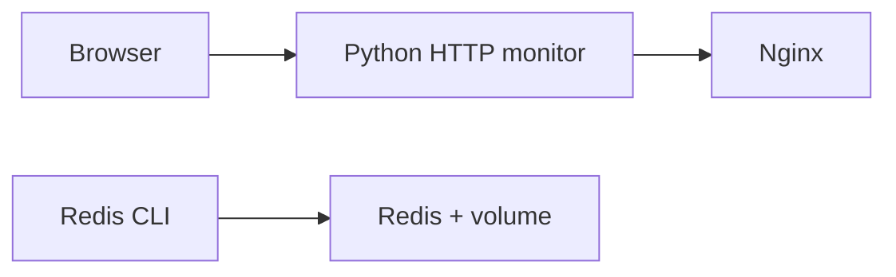

# Docker Infrastructure Lab

インフラエンジニア志望者向けのローカル学習環境です。Docker Composeによるサービス監視、Redisの永続化、障害対応を学ぶための追加課題です。

## 構成



実装状況は各ファイルを参照してください。公開サーバーへのデプロイは想定しません。

## 学習目標

- コンテナ間通信と名前解決
- ヘルスチェックと永続化
- HTTP監視と障害復旧
- 実測結果を記録し、設計判断を説明する

## 既存作品

- [STR2](https://github.com/efi0794/str2): Oracle DB学習
- [STR](https://github.com/efi0794/str): Cloudflare構成
- [tokitoki_1](https://github.com/efi0794/tokitoki_1): セキュリティ教材

AI支援で追加した学習用サンプルです。実行・検証の結果は自分で記録してください。

## 起動方法

Docker Desktop または Docker Engine + Compose v2 を用意し、次を実行します。

```bash
git clone https://github.com/efi0794/docker-kvs.git
cd docker-kvs
docker compose up -d
docker compose ps
```

- Web: http://127.0.0.1:8080
- 監視結果JSON: http://127.0.0.1:8081
- [障害対応・実測手順](docs/runbook.md)

終了: `docker compose down`（データボリュームは保持）。

## 現時点の制約

HTTP監視は固定の内部サービスのみ、5秒間隔、直近120件のメモリ保存です。成功率はこの観測窓の割合で、長期SLAではありません。Redisは独立した永続化演習です。実機での動作確認は未実施です。
