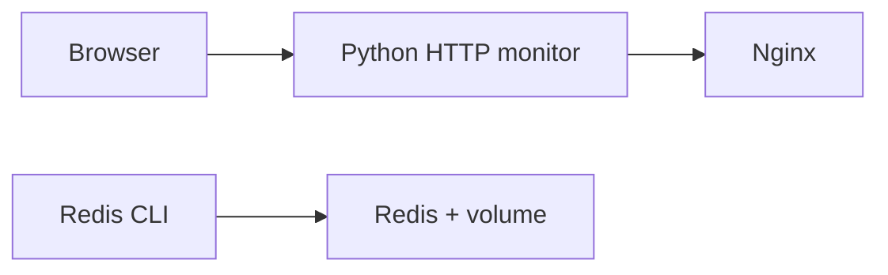

# Docker Infrastructure Lab

インフラエンジニア志望者向けのローカル学習環境です。Docker Composeによるサービス監視、Redisの永続化、障害対応を学ぶための追加課題です。

## 構成

実装状況は各ファイルを参照してください。公開サーバーへのデプロイは想定しません。

## 学習目標

- コンテナ間通信と名前解決
- ヘルスチェックと永続化
- HTTP監視と障害復旧
- 実測結果を記録し、設計判断を説明する

## 既存作品

- [STR2](https://github.com/efi0794/str2): Oracle DB学習
- [STR](https://github.com/efi0794/str): Cloudflare構成
- [tokitoki_1](https://github.com/efi0794/tokitoki_1): セキュリティ教材

AI支援で追加した学習用サンプルです。実行・検証の結果は自分で記録してください。
